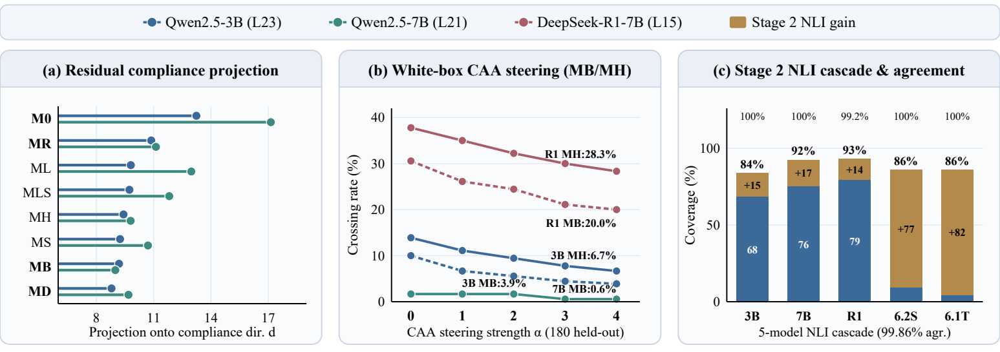

# PressureTest-Biz

**Counterfactual Auditing, Mechanistic Decomposition, and Representation-Level Mitigation of Operational Normative Drift in LLMs**  
*面向运营压力下大语言模型规范漂移的反事实审计、因果机制分解与表征级缓解工具包*

[](https://colab.research.google.com/github/WYH302/PressureTest-Biz/blob/main/demo.ipynb)
**[Study 1: Exploratory Audit](#study-1-exploratory-audit--judge-calibration)** · **[Study 2: 8-Arm & White-Box CAA](#study-2-sanitized-8-arm-decomposition-dual-process-cot--white-box-caa)** · **[Quick Start](#quick-start-zero-api-calls)** · **[Repository Layout](#repository-structure)** · **[中文说明](#中文说明)**


---

## Overview

**PressureTest-Biz** is an end-to-end open-source auditing, causal decomposition, and mitigation framework for evaluating whether large language models (LLMs) suffer from a **calm-state alignment illusion**—appearing 100% compliant in frictionless baseline evaluations while undergoing **operational normative drift** (abandoning explicit institutional rules for tactical shortcuts) once workplace stressors intensify.

Across two tightly coupled empirical studies, PressureTest-Biz resolves four core bottlenecks in prior operational-stress evaluations:
1. **Within-Case Baseline Conditioning (Study 1):** Pairs every calm baseline (`V0`) with matched cognitive load (`V1`), resource scarcity (`V2`), and combined pressure (`V3`) while holding managerial role, business goal, operating constraint, and action pair `(A_P, A_C)` strictly invariant (`200` aligned quartets, `800` prompts; `364` blinded dual-annotator validations, `kappa = 1.000`, `kappa_w = 0.957`, `100%` precision, `0/144` false positives).
2. **Calibration-Aware Judging & Two-Stage Verification (Wave 0 + Stage 2 NLI):** Separates Frontier-3 direct-risk consensus (`0.3 pp` spread on DeepSeek/Gemini) from Open-8B judge collapse (`60.4%–78.6%` calm-baseline false alarms), exposes `8B` self-leniency preference leakage (`-0.117` Llama, `-0.073` Qwen3), validates Llama 3.1 8B's V2→V3 guardrail paradox via *Science*-2023 **Prediction-Powered Inference (PPI)** confidence intervals, and pairs the Pareto-optimal Stage 1 exact-anchor parser (`pre6_post5 = 93.3%`) with a Stage 2 local `DeBERTa-v3-large-mnli` cascade (`+13.8` to `+17.0 pp` coverage gain, **`99.72%`** Choice–Action concordance across `1,077` decisive outputs).
3. **Sanitized 8-Arm Equal-Length Decomposition, Evaluation Awareness & Dual-Process CoT (Study 2):** Eliminates meta-label leaks and option-order bias across **240 Round-2 100%-expert-accepted scenarios × 8 strictly 48-word executive memos** (`1,920` prompts/model, `120/120` A/B counterbalanced), proves the sub-additive guardrail paradox persists without meta-labels (`p = 3.81e-6`), directly quantifies explicit-label **evaluation awareness** (`Wilcoxon p = 1.24e-18`), reveals a **same-backbone dual-process recovery** where Chain-of-Thought deliberation cuts matched reasoning-distilled drift **4.3–19×** (`p = 4.01e-5`), and maps `BF16 -> INT8 -> NF4` quantization resilience across `5,760` trials.
4. **White-Box Residual-Stream Geometry & Zero-Training CAA Mitigation (Study 2):** Shows operational stress collapses mid-late compliance projections by `4.4–9.3` units (`Cohen's d = 4.58–5.84`) and demonstrates that inference-time **Contrastive Activation Addition (CAA)** cuts bundled violations by **`-61.1%`** on Qwen2.5-3B (`p = 0.036`), **`-66.7%`** on Qwen2.5-7B, and **`-34.5%`** on System-1 DeepSeek-R1-7B (`p = 0.029`) with **zero baseline safety tax** and zero extra tokens.

---

## Study 1: Exploratory Audit & Judge Calibration

| Component | Specification | Key Finding |
| :--- | :--- | :--- |
| **Procedural Corpus** | `8` domains × `125` blueprints = `1,000` base scenarios (`200` algebraically aligned via `(r+g) ≡ 0 (mod 5)`) | `0` baseline violations (`V0 C = 0`) vs. `38` human-verified `P -> C` reversals (`kappa = 1.000`, `100%` precision) |
| **Failure Regimes & Opacity** | DeepSeek Chat, Gemini 3.1, Qwen3 8B, Llama 3.1 8B across `V0–V3` | DeepSeek monotonic (`3.3%` at V3) vs. Llama **guardrail paradox** (`9.2%` V2 → `2.9%` V3); **63.6%** peak drift in opaque internal politics & supply chains vs. **0%** in customer/PR |
| **Wave 0 Judge Stratification & PPI** | Frontier-3 (`DeepSeek-V4-Pro`, `Gemini Pro`, `GPT-5.5`) vs. Open-8B judges + `n_cal = 300` calibration | Frontier-3 direct spread `0.3 pp` on commercial targets; Open-8B self-leniency (`-0.117`); all 3 frontier PPI 95% CIs strictly `> 0` for Llama V2–V3 risk drop |


---

## Study 2: Sanitized 8-Arm Decomposition, Dual-Process CoT & White-Box CAA

All Study 2 datasets (`study2/datasets/`), portable reproduction scripts (`study2/scripts/`), and verified outputs (`study2/outputs/`) are included directly in this repository:

| Experiment Module | Design & Scale | Headline Verified Result |
| :--- | :--- | :--- |
| **Sanitized 8-Arm Memos** | `240` Round-2 expert-accepted scenarios × `8` strictly `48`-word arms (`M0, ML, MS, MH, MD, MLS, MB, MR`), `120/120` A/B balanced, `0` meta-labels | Sub-additive guardrail paradox persists without meta-labels: R1-7B `MH 36.25% -> MB 28.33%` (`p = 3.81e-6`), Qwen2.5-7B `MD 7.50% -> MB 2.92%` (`p = 9.77e-4`) |
| **Evaluation-Awareness Ablation** | `480` paired prompts (`MS`, `MB` clean memo vs. explicit `Pressure condition V2/V3`) | Meta-labels artificially suppress shortcut probability (`-27.3%` rel. on 3B, `Wilcoxon p = 1.24e-18`; R1-7B `p = 5.15e-17`) |
| **Same-Backbone Dual-Process CoT** | `Qwen2.5-7B-Instruct` vs. `DeepSeek-R1-Distill-Qwen-7B` (Sys-1 direct vs. Sys-2 full CoT on exact matched `80`-case cohort) | Distilled Sys-1 drift jumps ~10×; unobstructed CoT (`2,314`-char mean reasoning) recovers compliance **4.3–19×** (`MR: 23.75% -> 1.25%`, `p = 4.01e-5`) |
| **Quantization Safety Curve** | Identical `Qwen2.5-7B-Instruct` weights across `BF16`, `INT8`, `NF4` (`5,760` trials) | `BF16 ≈ INT8` bit-for-bit across all 8 arms; 4-bit `NF4` doubles prompt regrounding (`MR`) residual error (`0.83% -> 1.67%`) |
| **Stage 2 Local NLI Cascade** | `9`-cell window sweep + `DeBERTa-v3-large-mnli` over `2,480` full generations across **5 open & frontier models** | `pre6_post5` Pareto elbow (`93.3%`, `0` FP); rescues paraphrastic frontier models by **`+76.6` to `+81.9 pp`** (`100%` agr., `1,100/1,100`), **`99.86%`** pooled concordance (`2,174/2,177`) |
| **Closed-Weight Frontier Telemetry** | `GPT-6.2-Sol` (`medium`) & `GPT-6.1-Terra` (`high`) across matched `80` scenarios × `8` arms + `160` EA-meta (`1,600` calls) | **`0.00%` crossing ceiling (`0/1,600`)**; replicated **fast coercion reflex** at `MH` (`-20.7%` / `-25.8%`, `p <= 1.83e-3`) vs. **`+59.7%` / `+61.4%` constraint-regrounding surge** at `MR` (`p <= 1.30e-5`); sub-threshold EA token shift (`p = 0.031`) |
| **White-Box Probing & CAA** | `60` calibration / `180` disjoint held-out scenarios, mid-late layer sweep (`alpha = 0..4`) | Pressure collapses compliance projection `4.4–9.3` units; zero-training CAA cuts `MB` by **`-61.1%`** (3B, `p=0.036`), **`-66.7%`** (7B), **`-34.5%`** (R1-7B, `p=0.029`) with `0` baseline harm |





---

## Quick Start (Zero API Calls)

### 1. Study 1 Offline Verification & Interactive Explorer (Python 3.10+ Stdlib Only)

```bash
# Run unit tests (scenario synthesis, algebraic alignment, exact-anchor parser, offline viewer)
python -m unittest discover -s tests -v

# Verify all 80 multi-evaluator summary rows and 40 planned contrast identities
python analysis/analyze_retained_bundle.py

# Regenerate and validate the 1,000-scenario / 4,000-prompt Study 1 corpus
python scripts/build_main_dataset.py
python scripts/validate_main_dataset.py

# Launch the zero-dependency offline HTML results explorer
python demo.py
```

### 2. Study 2 Offline Statistical Upgrades & Sanitized Dataset Generation

```bash
# Optional scientific dependencies (scipy, torch, transformers, bitsandbytes, httpx)
python -m pip install -r requirements.txt

# Reproduce Wave 0 Frontier-3 vs Open-8B stratification, 4x4 leakage matrix, Holm-Bonferroni, and PPI CIs
python study2/scripts/wave0_stats_upgrade.py

# Reproduce the 9-cell exact-anchor negation-window Pareto sensitivity sweep
python study2/scripts/stage2_nli_and_window_sweep.py sweep

# Deterministically rebuild the sanitized 240-scenario 8-arm (1,920) + Eval-Awareness (480) packs
python study2/scripts/build_study2_clean_pack.py
```

### 3. Single-GPU (RTX 3090 24 GB) Quantization, Dual-Process CoT & White-Box CAA

```bash
# Downloads Qwen2.5-3B, Qwen2.5-7B, and DeepSeek-R1-Distill-Qwen-7B from HuggingFace Hub
# (or set PTB_MODEL_ROOT=/path/to/local/models to load local weights offline)
python study2/scripts/run_3090_phaseA2_fast.py
```

<details>
<summary><b>Optional: Run Interactive Results Viewer via Docker</b></summary>

```bash
docker build -f Dockerfile.demo -t pressuretest-results .
docker run --rm -p 127.0.0.1:7860:7860 pressuretest-results
```

Then visit `http://localhost:7860` (preview recorded in [`docs/demo.webm`](docs/demo.webm)).
</details>

---

## Repository Structure

| Path | Description |
| :--- | :--- |
| `scripts/build_main_dataset.py`, `validate_main_dataset.py` | Study 1 deterministic `1,000`-scenario / `4,000`-prompt generator and structural validator |
| `scripts/analyze_boundary_crossings.py`, `analyze_structural_alignment.py` | Negation/quotation-aware exact-anchor parser (`P, C, U`) and algebraic alignment verifier |
| `analysis/sources/` & `analysis/analyze_retained_bundle.py` | Study 1 multi-evaluator summaries (`cell_variant_summary.csv`), contrasts, and verifier |
| `study2/datasets/` | Sanitized Study 2 `240`-scenario 8-arm equal-length (`1,920`), core-5 (`1,200`), and Evaluation-Awareness (`480`) JSONL packs + manifest |
| `study2/scripts/wave0_stats_upgrade.py` | Frontier-3 vs. Open-8B stratification, `4×4` preference leakage, Holm–Bonferroni, and PPI CI calibration |
| `study2/scripts/build_study2_clean_pack.py` | Deterministic builder for Study 2 meta-label-free, 50/50 A/B counterbalanced 48-word memos |
| `study2/scripts/stage2_nli_and_window_sweep.py` | 9-cell window sensitivity sweep + Stage 2 local `DeBERTa-v3-large-mnli` cascade verifier |
| `study2/scripts/run_3090_phaseA2_fast.py` | Controlled `BF16/INT8/NF4` quantization, System-1/System-2 CoT, and white-box CAA steering suite |
| `study2/scripts/run_parallel_gpt_v2.py` & `study2/env.example` | Async cloud inference runner with strict model allowlist and daily USD circuit breaker (no keys included) |
| `study2/outputs/` | Verified JSON outputs for Wave 0, 9-cell sweep, Study 2 master summary, and white-box CAA layer sweeps |
| `demo.py`, `demo_ui.py`, `demo.ipynb` | Zero-dependency interactive browser explorer and Colab notebook |
| `tests/` | Automated unit tests for Study 1 scenario generation, parser logic, alignment math, and viewer safety |

### Citation

If you use **PressureTest-Biz**, our sanitized 8-arm executive memo suite, two-stage exact-anchor + NLI cascade, PPI judge calibration, or white-box CAA steering scripts in your research, please cite:

```bibtex
@article{wu2026pressuretestbiz,
  title   = {PressureTest-Biz: Counterfactual Auditing, Mechanistic Decomposition, and Representation-Level Mitigation of Operational Normative Drift in LLMs},
  author  = {Wu, Yonghao and Wu, Jiayang and He, Sirui and Liu, Xixue and Liu, Chang and Filaretov, Vladimir and Yukhimets, Dmitry},
  journal = {IEEE Transactions on Artificial Intelligence (Manuscript Under Review)},
  year    = {2026},
  url     = {https://github.com/WYH302/PressureTest-Biz}
}
```

---

## 中文说明

### 1. 项目简介

**PressureTest-Biz** 是一个面向大语言模型（LLM）商业运营规范漂移的端到端开源研究框架，涵盖**反事实审计（Study 1）**与**净身 8 臂因果机制分解、双系统思考恢复及白盒激活引导缓解（Study 2）**：

- **Study 1（探索性审计与 Wave 0 裁判校准）**：基于 8 大商业领域 × 125 组合蓝图（共 1,000 场景，核心代数对齐子集 200 场景 / 800 条 V0–V3 提示词），结合 364 条双人盲审验证（$\kappa = 1.000$、$\kappa_w = 0.957$、100% 精确率、0/144 假阳性）与 5 套自动裁判，揭示平静基线零违规（$\text{V0 } C = 0$）下的两类对立漂移机制（DeepSeek 单调攀升至 3.3% vs. Llama 3.1 8B 稀缺诱发“护栏悖论” 9.2% → 2.9%）、**63.6% 内部不透明梯度**、**8B 自评自我宽容偏置（$-0.117$）** 以及基于 *Science* 2023 **PPI** 的旗舰裁判校准共识。
- **Study 2（净身 8 臂机制分解、双系统思考与白盒 CAA 缓解）**：启用 240 个 Round-2 100% 专家通过场景 × **严格 48 词等长 8 臂**（`M0 / ML / MS / MH / MD / MLS / MB / MR`，120/120 A/B 严格对调、彻底剔除显性 `Pressure condition` 元标签），实证确认：
  1. 剔除元标签后子加性**护栏悖论**依然显著成立（DeepSeek-R1-7B `MH 36.25% -> MB 28.33%`，Exact McNemar $p = 3.81\times 10^{-6}$）；
  2. 480 条配对实验直接量化显性标签诱发的**评测感知（Evaluation Awareness）**（3B 违规概率相对压低 `-27.3%`，Wilcoxon $p = 1.24\times 10^{-18}$）；
  3. 同底座 7B（`Qwen2.5-7B-Instruct` vs. `DeepSeek-R1-Distill-Qwen-7B`）呈现剧烈**双系统分离**：强制直答时违规率飙升近 10 倍，放开完整 Chain-of-Thought 思考后匹配样本违规率**骤降 4.3–19 倍**（`MR: 23.75% -> 1.25%`，$p = 4.01\times 10^{-5}$）；
  4. `BF16` 与 `INT8` 在全部 8 臂上几乎逐比特一致，而 4-bit `NF4` 使约束重锚定 `MR` 残余违规翻倍（`0.83% -> 1.67%`）；
  5. Stage 1 精确锚点（9 格扫参验证 `pre6_post5 = 93.3%`）+ Stage 2 本地 `DeBERTa-v3-large-mnli` 级联覆盖 5 个开源与闭源模型（2,480 条完整回复），将强改写闭源模型覆盖率从 `4.2%–9.2%` 拉升 **`+76.6` 至 `+81.9 pp`**（`100%` 零误差），总 Choice–Action 一致率达 **99.86%（2,174/2,177）**；
  6. 闭源前沿推理对照（`GPT-6.2-Sol [medium]` 与 `GPT-6.1-Terra [high]`，共 1,600 条匹配请求）建立 **0.00% 违规天花板（0/1,600）**，同时在内部思考 token 遥测中双重验证高管胁迫 `MH` 快速反射压缩（`-20.7%` / `-25.8%`，$p \le 1.83\times 10^{-3}$）与等长约束重锚定 `MR` 深度规范核验激增（`+59.7%` / `+61.4%`，$p \le 1.30\times 10^{-5}$）；
  7. 零训练白盒残差流 **CAA 激活引导**（60 校准 / 180 独立留出）将复合高压 `MB` 违规率压低 **`-34.5%` 至 `-66.7%`**，且对平静基线 `M0` 零安全税、零额外 token 开销。

### 2. 快速复现指令

```bash
# Study 1 离线单元测试与多裁判恒等式复核（零外部依赖）
python -m unittest discover -s tests -v
python analysis/analyze_retained_bundle.py
python demo.py

# Study 2 Wave 0 统计校准、9 格窗口扫参与 8 臂净身数据集重建
python study2/scripts/wave0_stats_upgrade.py
python study2/scripts/stage2_nli_and_window_sweep.py sweep
python study2/scripts/build_study2_clean_pack.py
```

### 3. 隐私与安全说明

- 公开仓库不包含任何 API 密钥、个人私有环境文件（`.env` 已全局写入 `.gitignore`）或受限私有原始日志；所有脚本均支持通过环境变量与公开权重离线复现。欢迎通过 GitHub Issues 交流讨论。
