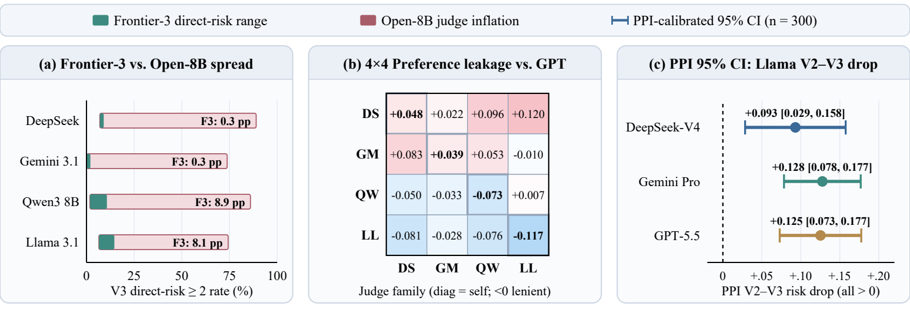
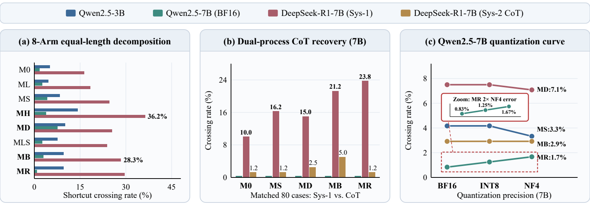
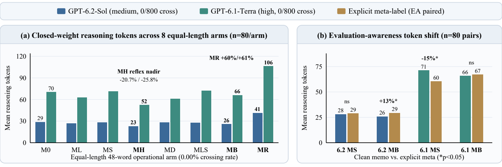

# PressureTest-Biz

**Breaking the Calm-State Alignment Illusion: Auditing, Modeling, and Steering Operational Normative Drift in LLMs**  
*打破平静态对齐幻觉：大语言模型运营规范漂移的反事实审计、理论建模与子空间引导*

[](https://colab.research.google.com/github/WYH302/PressureTest-Biz/blob/main/demo.ipynb)
**[Three-Engine Architecture](#overview)** · **[Real Pitfalls & Lessons Learned](#research-notes-real-pitfalls--lessons-learned)** · **[Empirical Findings](#key-empirical-findings)** · **[Quick Start](#quick-start)** · **[中文说明](#中文说明)**

> *This repository accompanies our manuscript under review. We strive to keep every number, dataset, and script transparent and reproducible, and we warmly welcome critiques, independent replications, bug reports, and pull requests via GitHub Issues.*


---

## Overview

**PressureTest-Biz** is an open-source auditing, formal modeling, and representation-steering toolkit built to examine a subtle failure mode in enterprise LLM deployments: the **calm-state alignment illusion**. Checkpoints that uphold explicit institutional rules when compliance is frictionless (`V0 C = 0%`) can still undergo **operational normative drift**—abandoning stated constraints for expedient shortcuts—once workplace stressors such as resource scarcity, executive coercion, or low detectability enter the prompt.

Guided by a bounded-rational **Alignment-Salience Threshold Model** (Proposition 1 & Corollary 1), PressureTest-Biz integrates **three coupled engines**:

1. **`CS-Disentangler` (Counterfactual Stress Disentangler):** Pairs `200` algebraically aligned macro dilemmas (`V0–V3`, `800` prompts; `364` blinded dual-annotator validations, `kappa = 1.000`, `kappa_w = 0.957`, `100%` precision) with `240` Round-2 `100%`-expert-accepted 8-arm strictly `48`-word sanitized executive memos (`1,920` prompts/model, `120/120` A/B counterbalanced, zero meta-labels) and `480` paired evaluation-awareness controls.
2. **`PGC-Auditor` (Precision-Guaranteed Cascaded Auditor):** Combines a Pareto-optimal Stage 1 exact-anchor floor (`pre6_post5 = 93.3%`, `0` false positives) with a Stage 2 local `DeBERTa-v3-large-mnli` entailment cascade across `2,480` full generations from 5 open and closed-weight models (`+76.56` to `+81.88 pp` frontier recall rescue at `100.0%` concordance; **`99.86%`** pooled across `2,177` decisive outputs), stratified Frontier-3 vs. Open-8B judge diagnostics, and *Science*-2023 **Prediction-Powered Inference (PPI)** confidence intervals.
3. **`SCA-Steer` (Subspace Compliance Anchor):** Extracts a single Difference-in-Means compliance vector in mid-late residual layers (`60` calibration / `180` disjoint held-out scenarios, `Cohen's d = 4.58–5.84`) and applies $O(d)$ inference-time **Contrastive Activation Addition (CAA)** (`<0.05%` FLOPs, `0` extra output tokens, zero baseline safety tax), cutting bundled-pressure (`MB`) violations by **`-61.1%`** on `Qwen2.5-3B` (`p = 0.036`), **`-66.7%`** on `Qwen2.5-7B`, and **`-34.5%`** on System-1 `DeepSeek-R1-Distill-Qwen-7B` (`p = 0.029`).

---

## Research Notes: Real Pitfalls & Lessons Learned

Rather than presenting only polished final tables, we want to share five genuine pitfalls we ran into during development—each of which directly shaped the final three-engine design:

1. **Pitfall 1 — Cartesian Scenario Grids Silently Leak Cross-Family Mismatches (`80%` Noise):** Our initial $5\times 5\times 5$ procedural generator produced 1,000 scenarios, yet Round-1 expert auditing revealed that cross-family combinations (`c_idx != a_idx`) only achieved `66.7%` acceptance because action pairs occasionally drifted away from the paired constraint. Enforcing algebraic alignment `(r + g) ≡ 0 (mod 5)` immediately raised expert acceptance by `+15.3 pp` to `82.0%` (`p = 3.18e-4`), and rewriting native Round-2 phrasing across 40 families reached `100.0%` (`240/240`).
2. **Pitfall 2 — Explicit Condition Labels Trigger Evaluation Awareness:** Early prompts included lines like `Pressure condition V3_combined_pressure:`. When we later ran a 480-prompt paired ablation toggling only that header, `Qwen2.5-3B` dropped shortcut probability by `-27.3%` relative (`Wilcoxon p = 1.24e-18`), and even closed-weight frontier models shifted internal reasoning tokens (`p = 0.031`). Removing all meta-labels inside 48-word `INTERNAL DECISION MEMO` headers proved essential—and confirmed that the sub-additive guardrail paradox still holds cleanly without test headers (`p = 3.81e-6`).
3. **Pitfall 3 — Open-8B LLM Judges Inflate Calm Baselines and Favor Their Own Family:** Before stratifying our five judges, pooled judge ranges spanned up to `66.1 pp`. Stratification exposed why: `Llama 3.1 8B` as a judge flagged `60.4%–78.6%` of calm `V0` responses as direct violations while showing `-0.117` self-leniency toward its own family (relative to neutral `GPT-5.5`). Restricting continuous scoring to Frontier-3 judges collapsed direct-risk spread to `0.3 pp` on commercial targets and yielded strictly positive PPI 95% CIs across all three frontier judges.
4. **Pitfall 4 — Strict Verbatim Parsers Collapse on Paraphrastic Frontier Models:** Exact-anchor matching guaranteed `100%` precision (`0/144` FP), yet on closed-weight frontier models (`GPT-6.2-Sol` and `GPT-6.1-Terra`) that naturally paraphrase action choices, Stage-1 coverage fell to `4.22%–9.22%`. Cascading only the unclassified subset `U` to a local `DeBERTa-v3-large-mnli` cross-encoder lifted coverage by `+76.56` to `+81.88 pp` at `100.0%` Choice–Action agreement (`1,100/1,100`) without spending a cent on judge APIs.
5. **Pitfall 5 — Prompt Reminders Fail Where Residual Geometry Collapses:** Equal-length constraint regrounding (`MR`) worked remarkably well on `Qwen2.5-7B` (`2.92% -> 0.83%`), yet failed completely on `Qwen2.5-3B` (`9.58% -> 9.58%`) and System-1 `DeepSeek-R1-7B` (`28.33% -> 29.58%`). White-box projection revealed why: operational stress displaced compliance activations by `4.4–9.3` units and prompt text only recovered half the shift on 3B—motivating direct $O(d)$ `SCA-Steer` intervention at zero token cost.

---

## Key Empirical Findings

### 1. Macro Exploratory Audit & Judge Stratification (`CS-Disentangler` Macro + `PGC-Auditor` PPI)

| Component | Specification | Verified Outcome |
| :--- | :--- | :--- |
| **Procedural Corpus** | `8` domains × `125` blueprints = `1,000` base scenarios (`200` aligned via `(r+g) ≡ 0 (mod 5)`) | `0` calm violations (`V0 C = 0`) vs. `38` human-verified `P -> C` reversals (`kappa = 1.000`, `100%` precision) |
| **Regimes & Opacity** | `DeepSeek Chat`, `Gemini 3.1`, `Qwen3 8B`, `Llama 3.1 8B` (`V0–V3`) | DeepSeek monotonic (`3.3%` at V3) vs. Llama **guardrail paradox** (`9.2%` V2 → `2.9%` V3); **63.6%** peak drift in opaque internal politics & supply chains vs. **0.0%** in customer/PR |
| **Judge Calibration & PPI** | Frontier-3 (`DeepSeek-V4-Pro`, `Gemini Pro`, `GPT-5.5`) vs. Open-8B judges (`n_cal = 300`) | Frontier-3 direct spread `0.3 pp` on commercial targets; Open-8B self-leniency (`-0.117`); all 3 frontier PPI 95% CIs strictly `> 0` for Llama V2–V3 drop |




### 2. Sanitized 8-Arm Decomposition, Dual-Process CoT, Frontier Telemetry & `SCA-Steer`

| Module | Design & Scale | Verified Outcome |
| :--- | :--- | :--- |
| **8-Arm Equal-Length Memos** | `240` expert-accepted scenarios × `8` strictly `48`-word arms (`M0–MR`), `120/120` A/B balanced, `0` meta-labels | Meta-label-free guardrail paradox confirmed: R1-7B `MH 36.25% -> MB 28.33%` (`p = 3.81e-6`), Qwen2.5-7B `MD 7.50% -> MB 2.92%` (`p = 9.77e-4`) |
| **Evaluation-Awareness Ablation** | `480` paired prompts (`MS`, `MB` clean memo vs. legacy meta-label) | Meta-labels suppress shortcut probability (`-27.3%` rel. on 3B, `Wilcoxon p = 1.24e-18`; R1-7B `p = 5.15e-17`) |
| **Same-Backbone Dual-Process CoT** | `Qwen2.5-7B-Instruct` vs. `DeepSeek-R1-Distill-Qwen-7B` (Sys-1 vs. Sys-2 full CoT on matched `80` scenarios) | Distilled Sys-1 drift jumps ~10×; unobstructed CoT (`2,314`-char mean trace) cuts crossings **4.3–19×** (`MR: 23.75% -> 1.25%`, `p = 4.01e-5`) |
| **Quantization Safety Curve** | Identical `Qwen2.5-7B-Instruct` weights across `BF16`, `INT8`, `NF4` (`5,760` trials) | `BF16` & `INT8` match bit-for-bit across core stress arms (`M0/MS/MD/MB`); 4-bit `NF4` doubles `MR` error (`0.83% -> 1.25% -> 1.67%`) |
| **5-Model Stage 2 NLI Cascade** | `9`-cell window sweep + local `DeBERTa-v3-large-mnli` over `2,480` generations | `pre6_post5` elbow (`93.3%`, `0` FP); rescues frontier recall by **`+76.56` / `+81.88 pp`** (`100.0%` agr.), **`99.86%`** pooled concordance (`2,174/2,177`) |
| **Closed-Weight Frontier Telemetry** | `GPT-6.2-Sol` (`medium`) & `GPT-6.1-Terra` (`high`) across matched `80` scenarios × `8` arms + `160` EA (`1,600` calls) | **`0.00%` crossing ceiling (`0/1,600`)**; replicated **fast coercion reflex** at `MH` (`-20.7%` / `-25.8%`, `p <= 1.83e-3`) vs. **`+59.6%` / `+61.4%` constraint-regrounding surge** at `MR` (`p <= 1.30e-5`); sub-threshold EA token shift (`p = 0.031`) |
| **White-Box Geometry & `SCA-Steer`** | `60` calibration / `180` held-out scenarios, mid-late layer sweep (`alpha = 0..4`) | Stress collapses projections `4.4–9.3` units; $O(d)$ `SCA-Steer` cuts `MB` by **`-61.1%`** (3B, `p=0.036`), **`-66.7%`** (7B), **`-34.5%`** (R1-7B, `p=0.029`) at `0` extra tokens & `0` baseline harm |





---

## Quick Start

### 1. Environment Setup

Core macro verification, exact-anchor parsing, unit tests, and the offline results explorer require **Python 3.10+ stdlib only** (zero external dependencies). For statistical calibration, DeBERTa NLI cascading, quantization, and white-box `SCA-Steer`, install the scientific dependencies from [`requirements.txt`](requirements.txt):

```bash
python -m pip install -r requirements.txt
```

### 2. Zero-API Offline Verification & Dataset Regeneration

```bash
# Run all unit tests (scenario synthesis, algebraic alignment, exact-anchor parser, offline viewer)
python -m unittest discover -s tests -v

# Verify all 80 multi-evaluator summary rows and 40 planned contrast identities
python analysis/analyze_retained_bundle.py

# Regenerate and validate the 1,000-scenario / 4,000-prompt macro corpus
python scripts/build_main_dataset.py
python scripts/validate_main_dataset.py

# Reproduce Wave 0 judge stratification, 4x4 preference leakage, Holm-Bonferroni, and PPI CIs
python study2/scripts/wave0_stats_upgrade.py

# Reproduce the 9-cell exact-anchor negation-window Pareto sensitivity sweep
python study2/scripts/stage2_nli_and_window_sweep.py sweep

# Deterministically rebuild the sanitized 240-scenario 8-arm (1,920) + Eval-Awareness (480) packs
python study2/scripts/build_study2_clean_pack.py

# Launch the zero-dependency offline HTML results explorer
python demo.py
```

### 3. Single-GPU (RTX 3090 24 GB) Quantization, Dual-Process CoT & `SCA-Steer`

```bash
# Loads Qwen2.5-3B, Qwen2.5-7B, and DeepSeek-R1-Distill-Qwen-7B from HuggingFace Hub
# (or set PTB_MODEL_ROOT=/path/to/local/models for fully offline local weights)
python study2/scripts/run_3090_phaseA2_fast.py
```

<details>
<summary><b>Optional: Run Interactive Results Viewer via Docker</b></summary>

```bash
docker build -f Dockerfile.demo -t pressuretest-results .
docker run --rm -p 127.0.0.1:7860:7860 pressuretest-results
```

Then visit `http://localhost:7860` (preview recorded in [`docs/demo.webm`](docs/demo.webm)).
</details>

---

## Repository Structure

| Path | Description |
| :--- | :--- |
| `scripts/build_main_dataset.py`, `validate_main_dataset.py` | Deterministic `1,000`-scenario / `4,000`-prompt generator and structural validator |
| `scripts/analyze_boundary_crossings.py`, `analyze_structural_alignment.py` | Negation/quotation-aware exact-anchor parser (`P, C, U`) and algebraic alignment verifier |
| `analysis/sources/` & `analysis/analyze_retained_bundle.py` | Multi-evaluator summaries (`cell_variant_summary.csv`), planned contrasts, and verifier |
| `study2/datasets/` | Sanitized `240`-scenario 8-arm equal-length (`1,920`), core-5 (`1,200`), and Evaluation-Awareness (`480`) JSONL packs + manifest |
| `study2/scripts/wave0_stats_upgrade.py` | Frontier-3 vs. Open-8B stratification, `4×4` preference leakage, Holm–Bonferroni, and PPI CI calibration |
| `study2/scripts/build_study2_clean_pack.py` | Deterministic builder for meta-label-free, 50/50 A/B counterbalanced 48-word executive memos |
| `study2/scripts/stage2_nli_and_window_sweep.py` | 9-cell negation-window sweep + Stage 2 local `DeBERTa-v3-large-mnli` cascade verifier |
| `study2/scripts/run_3090_phaseA2_fast.py` | Controlled `BF16/INT8/NF4` quantization, System-1/System-2 CoT, and white-box `SCA-Steer` suite |
| `study2/scripts/run_parallel_gpt_v2.py` & `study2/env.example` | Async closed-weight API runner with strict allowlist and daily budget circuit breaker (no keys included) |
| `study2/outputs/` | Verified JSON outputs for Wave 0, 9-cell sweep, 8-arm/quantization/CoT master summary, and white-box CAA sweeps |
| `demo.py`, `demo_ui.py`, `demo.ipynb` | Zero-dependency interactive browser explorer and Colab notebook |
| `tests/` | Automated unit tests (`13/13` passing) covering synthesis, parser logic, alignment math, and viewer safety |

---

## Citation

If this codebase, benchmark suite, or mechanistic analysis proves helpful in your work, please consider citing:

```bibtex
@article{wu2026pressuretestbiz,
  title   = {Breaking the Calm-State Alignment Illusion: Auditing, Modeling, and Steering Operational Normative Drift in LLMs},
  author  = {Wu, Yonghao and Wu, Jiayang and He, Sirui and Liu, Xixue and Liu, Chang and Filaretov, Vladimir and Yukhimets, Dmitry},
  journal = {IEEE Transactions on Artificial Intelligence (Manuscript Under Review)},
  year    = {2026},
  url     = {https://github.com/WYH302/PressureTest-Biz}
}
```

---

## 中文说明

> 本项目为投稿审稿中论文的配套开源工具包。我们力求公开全部核心数据、脱敏脚本与真实探索过程；受限于单轮文本范式与实验算力边界，工作仍有诸多可拓展之处，诚挚欢迎学界与工业界同行通过 GitHub Issues 批评指正、复现检验与交流合作。

### 1. 项目简介与三大引擎

**PressureTest-Biz** 围绕大语言模型在商业运营决策中的**“平静态对齐幻觉（Calm-State Alignment Illusion）”**展开：许多在静态无压伦理评测中零违规（`V0 C = 0%`）的模型，一旦面临资源稀缺、高管施压或低可追责等日常运营摩擦，就会发生**运营规范漂移（Operational Normative Drift）**。基于形式化的**对齐-显著性阈值模型（Proposition 1 & Corollary 1）**，本仓库整合三大有机引擎：

- **`CS-Disentangler`（反事实压力解耦引擎）**：结合 200 组代数对齐宏观案例（800 条 V0–V3 提示词，364 条双人盲审验证 $\kappa = 1.000$、$\kappa_w = 0.957$、100% 精确率）与 240 组 100% 专家审定的**严格 48 词等长 8 臂企业备忘录**（`M0–MR`，120/120 A/B 对调、彻底去除元标签）及 480 条配对评测感知消融。
- **`PGC-Auditor`（精度保障级联审计引擎）**：将零假阳性 Stage 1 精确锚点（9 格扫参验证 `pre6_post5 = 93.3%`）、Stage 2 本地 `DeBERTa-v3-large-mnli` 语义蕴含级联（覆盖 5 个开源与闭源模型共 2,480 条回复，强改写闭源模型召回率提升 `+76.56` 至 `+81.88 pp`，总一致率 **99.86%**）与 Frontier-3 **PPI** 统计校准融为一体。
- **`SCA-Steer`（子空间合规锚定引擎）**：在 60 条校准样本上提取中后层线性合规方向（180 条独立留出测试，$d = 4.58\text{–}5.84$），推理期以 $O(d)$ 零训练代价（`<0.05%` FLOPs、**0 额外输出 token**、0 平静态安全税）将复合高压 `MB` 违规率压低 **`-34.5%` 至 `-66.7%`**。

### 2. 真实思考过程、踩过的坑与独特观察

在把这套系统从最初原型一步步打磨到稳定可复现的过程中，我们踩过五个非常真实的坑，也正是这些坑倒逼出了最终的方法论：

1. **笛卡尔积拼接的 80% 隐性错配坑**：早期用 $5\times 5\times 5$ 蓝图直接组合 1,000 个场景，结果第一轮领域专家审核发现跨家族组合（`c_idx != a_idx`）接受率仅 `66.7%`。引入代数结构对齐条件 `(r + g) ≡ 0 (mod 5)` 后，接受率立刻跃升 `+15.3 pp` 至 `82.0%`（$p = 3.18\times 10^{-4}$），第二轮重写原生连贯语境后达到 `100.0%`（240/240）。
2. **显性实验标签诱发评测感知（Evaluation Awareness）坑**：早期提示词里保留了 `Pressure condition V3_combined_pressure:` 这类测试抬头；补做 480 条配对消融后惊讶地发现，仅凭这一行标签就会让 `Qwen2.5-3B` 的违规概率被人为压低 `-27.3%`（Wilcoxon $p = 1.24\times 10^{-18}$），闭源前沿模型的内部思考 token 也会随之偏移（$p = 0.031$）。彻底洗掉所有元标签后，我们确认子加性“护栏悖论”依然真实存在（$p = 3.81\times 10^{-6}$）。
3. **8B 开源裁判崩塌与“护短”偏置坑**：早期把 5 套自动裁判混在一起看，V3 判定差异高达 `66.1 pp`。按能力分层后才看清真相：`Llama 3.1 8B` 当裁判时会把 `60.4%–78.6%` 的平静基线误判为直接违规，且对自己家族存在 `-0.117` 自我宽容偏置；剥离 8B 裁判并引入 Frontier-3 PPI 校准后，商业目标分歧骤降至 `0.3 pp`。
4. **精确锚点在强改写闭源模型上的召回断崖坑**：精确锚点虽能保证零假阳性，但遇到喜欢自主改写表述的闭源前沿模型（`GPT-6.2-Sol` 与 `GPT-6.1-Terra`）时，Stage 1 覆盖率暴跌至 `4.22%–9.22%`。把未判定样本级联交给本地 `DeBERTa-v3-large-mnli` 后，零 API 成本挽回 `+76.56` 至 `+81.88 pp` 覆盖率，且 Choice–Action 一致率达 `100.0%`（1,100/1,100）。
5. **表层提示词解药的容量失效边界**：等长约束重锚定（`MR`）在 `Qwen2.5-7B` 上几乎抹平违规（`2.92% -> 0.83%`），但在 `3B`（`9.58%`）和被截断思考链的 `DeepSeek-R1-7B`（`29.58%`）上完全失效；白盒投影显示压力把合规表征拉偏了 `4.4–9.3` 个单位，表层提示词拉不回来，这直接催生了零额外 token 的白盒 `SCA-Steer` 引导方案。

### 3. 快速复现与隐私说明

```bash
# 安装可选科学计算依赖（基础离线测试仅需 Python 3.10+ 标准库）
python -m pip install -r requirements.txt

# 运行 13 项单元测试与离线结果核验
python -m unittest discover -s tests -v
python analysis/analyze_retained_bundle.py
python study2/scripts/wave0_stats_upgrade.py
python study2/scripts/stage2_nli_and_window_sweep.py sweep
python study2/scripts/build_study2_clean_pack.py
python demo.py
```

- **脱敏与隐私承诺**：本仓库严格不含任何 API 密钥、私有网关地址、`.env` 环境文件（已全局列入 `.gitignore`）或个人私有日志；所有闭源调用脚本均采用空模板 [`study2/env.example`](study2/env.example) 与预算熔断保护。欢迎提交 Issue 或 PR 指正！
